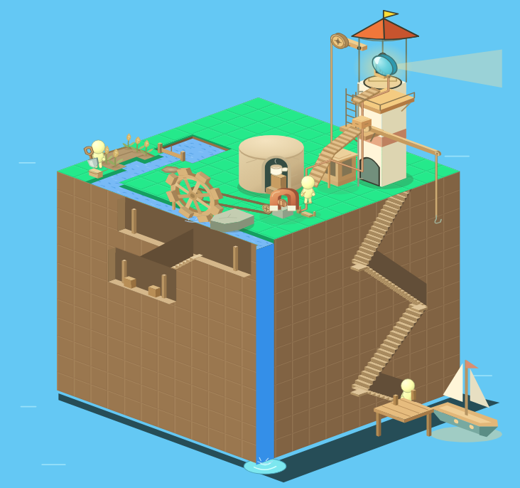
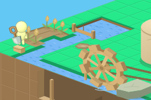
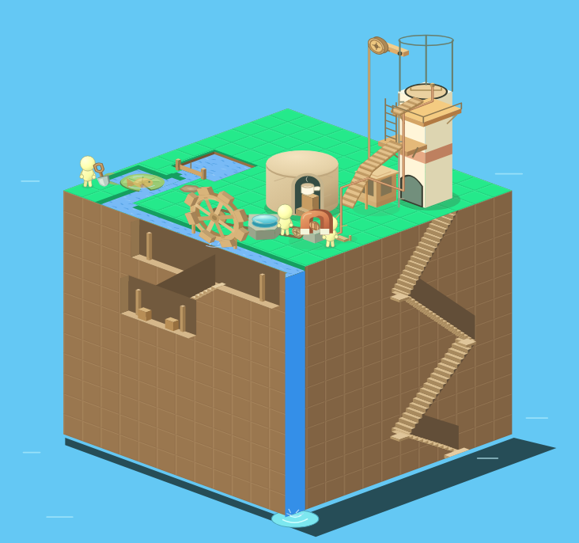

# Style sheet gier

Żywe źródło prawdy dla nowych gier i zmian wizualnych w tym projekcie.
Opisuje nie tylko kolory, ale też bryły, kompozycję, ruch i zachowanie świata.
Nie jest zamiennikiem `styles.css`: sam arkusz CSS nie opisze kontaktu dłoni z przedmiotem ani sensu przebudowy.

Bazą jest zaakceptowana 25 listopada 2026 wersja „Wyspy małych spraw”:
[`cee666c`](https://github.com/masumvotres-mati/iskra-quiz/commit/cee666c4f7cc172d515f671b1e8eab317f510082).
Odnośniki do kodu poniżej wskazują bieżącą implementację; obrazy są zapisanym wzorcem tej zaakceptowanej wersji.

## 1. Kierunek i wzorce

**Mały, czytelny, ciepły świat-zabawka. Miękkie bryły zamiast obrysowanych ikon. Każda zmiana ma przyczynę i fizyczne miejsce.**

Wzorzec całości: proporcje, ilość wolnego miejsca, światło, schody i przekrój podziemi.

Wzorzec materiałów: zagłębiona woda, ziemia przecięta kanałem, osobno osadzone rośliny i przestrzenne koło.

Wzorzec wariantu: ta sama estetyka i przestrzeń, ale inne zastosowanie terenu.

Nie przenosimy do nowych gier obowiązkowo kostki, ośmiu przedmiotów ani tych samych warunków zwycięstwa.
Przenosimy język plastyczny i zasady interakcji. Quiz nie musi stawać się izometryczną wyspą.

## 2. Bryły, materiały i światło

- Grafika świata to autorskie SVG 2D o przestrzennych kształtach, nie płaskie piktogramy ustawione na planszy.
  Nie wracamy do odrzuconej konwersji wyspy na Three.js/WebGL ani do jej wyglądu.
- Rozpoznawalność wynika z sylwetki, grubości i kilku czytelnych powierzchni. Kamień ma boczne ściany, blat ma rant, łopatka ma grubość.
- Bez dominujących ciemnych konturów na przedmiotach, budynkach i uprawach.
  Delikatna kreska może opisać drobny detal lub kończynę; nie powinna zastępować całej bryły.
  Obwódki przycisków interfejsu nie są wzorcem obrysowania świata.
- Światło jest wspólne: z góry i z lewej strony ekranu. Nie zmienia strony, gdy postać lub przedmiot się obraca albo odbija lustrzanie.
  Gradienty i refleksy dopasowujemy do aktualnej transformacji, nie ustawiamy każdego „na oko”.
- Materiały są spokojne: ciepłe drewno i ziemia, kremowy kamień, jasne ludziki, chłodna woda.
  Małe refleksy i oszczędna faktura są lepsze niż mocny połysk, ciężkie obrysy i nadmiar drobnych kresek.
- Cień kontaktowy leży na rzeczywistej podporze. Nie jest uniwersalną elipsą doklejoną pod lewitującym obiektem.

Paleta startowa, nie zakaz dodawania uzasadnionych materiałów:

| Rola | Kolory wzorca |
| --- | --- |
| Tło / morze | `#64c8f4` |
| Woda / delikatne refleksy | `#78baf6`, `#a3d2fb` |
| Trawa / brzeg wykopu | `#25e98b`, `#169e60` |
| Ziemia: góra i ściany kostki | `#b18860`, `#9a774f`, `#816343` |
| Ziemia uprawna | `#b69b70`, `#94794f` |
| Drewno: góra, bok, cień | `#f3ce8c`, `#e1ae6b`, `#bd8b52` |
| Kamień: światło, półton, cień | `#f4e3bf`, `#e5d1a7`, `#b49b72` |
| Postacie: ciało i cień | `#ffffad`, `#d9dd86` |
| Szkło | `#d4ffff`, `#7ee4ed`, `#3fb0c2` |
| Jednorazowe ulepszenie | `#fff9c0`, `#ffd33d`, `#ffbf24` |

Woda i architektura latarni są szczególnie ważnymi zaakceptowanymi wzorcami.
Nie zmieniamy ich przypadkiem przy poprawianiu innych elementów.

## 3. Kompozycja i postacie

Najpierw czytelna sylwetka całego świata na telefonie, dopiero potem detale.
Zostawiamy wolne pola, suche dojścia i miejsce na pracę mieszkańców.
Nie zagęszczamy wyspy dekoracjami tylko po to, żeby wyglądała na bardziej rozwiniętą.
Rozwój może odejmować materiał: wykop, schody i tunel są lepsze niż kolejna warstwa dodatków na górze.

Postacie są niewielkie, jasne, z dużą okrągłą głową, prostym tułowiem i zaokrąglonymi kończynami.
Nie dodajemy przypadkowych twarzy, kostiumów ani innego modelu proporcji dla każdej roli.
Pozę rozpoznajemy po całej sylwetce: kucanie, pchanie, niesienie, wspinanie i wiosłowanie muszą być różnymi czynnościami.
Stopy mają kontakt z podłożem także podczas pochylania tułowia.

## 4. Przestrzeń, warstwy i podpory

**Obiekt ma punkt podparcia i wysokość, a nie tylko pozycję obrazka.**

- Ziemia, zasiew i plamy gruntu należą do warstwy podłoża. Nie mogą przykrywać nóg postaci.
- Rośliny, skrzynki i postacie sortujemy osobno według ich rzeczywistych podstaw.
  Liście mogą prawidłowo zasłaniać postać stojącą z tyłu; nie rozwiązujemy problemów przez przeniesienie wszystkich ludzi na wierzch.
- Kanał wycina teren. Gleba nie może tworzyć nad nim przypadkowej pokrywy.
  Korzenie sadzimy poza otworem kanału, a nie tylko poza niebieskim kolorem jego powierzchni.
- Źródło i staw mają otwór w gruncie, ściany oraz wodę poniżej brzegu.
  Woda podąża po wspólnej geometrii świata; nie jest dowolną falistą linią.
- Liść spoczywa na faktycznej powierzchni wody, również po skalowaniu. Nie wystarczy, że jego środek jest „blisko stawu”.
- Szkło leży na wierzchu kamienia, na dnie kabiny albo w uchwycie. Ładunek dotyka pokładu lub podłogi swoim spodem.
  Różne przedmioty mają różne punkty podparcia; wspólny magiczny offset nie wystarcza.
- Schody, galerie i podziemia mają widoczną grubość lub wnętrze. Trasa mieszkańca korzysta z tej samej geometrii.
  Nie rysujemy schodów nad nadal używaną trasą drabiny.
- Łączone otwory i maski nie mogą wycinać w sobie dziur przez przeciwne kierunki obiegu wielokątów.
  Sprawdzamy szczególnie styki pokoju ze schodami i kolejne zakosy zejścia.

## 5. Chwyt i ruch

Przenoszenie ma cztery czytelne fazy: **podejście → chwyt → niesienie → odłożenie na podporę**.
Ten sam przedmiot przechodzi między nimi ciągle. Nie zostawiamy starego egzemplarza i nie pokazujemy nowego w innym miejscu.

Dłonie dotykają konkretnego miejsca przedmiotu lub powierzchni roboczej.
Ramiona mają stałe długości. Jeśli chwyt jest za daleko, poprawiamy pozycję postaci, dojście albo ustawienie przedmiotu,
zamiast wydłużać kończyny i nazywać to udanym kontaktem.
Przy dużym przedmiocie może być potrzebna druga dłoń lub druga postać.
Palce, burta i poręcz muszą być rysowane po właściwej stronie niesionego ładunku.

Ciężar jest widoczny: pchanie wymaga zaparcia, dwie osoby niosą blat razem, kabina podaje ładunek na podest.
Spadający przedmiot przyspiesza ku wodzie i wywołuje plusk przy lądowaniu.
Nie zawisa ani nie podskakuje bez powodu w połowie spadania.

Po zakończeniu czynności postać zostaje na miejscu.
Bez bezcelowego chodzenia, zapętlonego kopania i udawania pracy po zakończeniu tury.
Może nadal działać coś, co ma przyczynę: nurt, napędzane koło, kołysząca się łódka lub obracająca się latarnia.
Ręczne koło garncarskie nie obraca się samo po odejściu garncarza.

## 6. Przyczyna, postęp i satysfakcja

Każda interakcja odpowiada obrazem na pytania: **po co, czym, gdzie i dlaczego teraz?**
Krótki podpis może pomóc, ale nie powinien tłumaczyć zdarzenia, którego animacja w ogóle nie pokazuje.

| Problem, którego unikamy | Wzorzec |
| --- | --- |
| Ludzik nagle otwiera losową jamę | Wskazówka, cel działania, podejście do znanego miejsca, właściwe narzędzie |
| Przedmiot bez wyjaśnienia staje się innym urządzeniem | Widoczna ocena otoczenia i przebudowa istniejących części |
| Woda sama tworzy kanał | Łopata przygotowuje grunt, potem mieszkaniec prowadzi wykop i dopiero za nim płynie woda |
| Gotowe do pracy szkło czeka pustą turę | Natychmiastowy odbiór przy gotowym warsztacie; przed jego powstaniem widoczne obejrzenie i oczyszczenie |
| Kilka tur „pracy”, ale identyczny obraz | Kolejne znikające matowe pasy, rosnące rośliny, przybywające nacięcia lub widoczny etap konstrukcji |
| Jedno urządzenie zmienia zastosowanie bez przebudowy | Rola wynika z warunków w momencie budowy i trwa do uzasadnionej, pokazanej zmiany |
| Nowy element po prostu się pojawia | Przygotowanie, montaż lub wzrost, a dopiero potem stan ukończony |

Oczekiwanie na brakujący materiał jest czymś innym niż sztuczne opóźnienie mimo gotowych warunków.
Nie usuwamy bezmyślnie wszystkich zależności zagadki; zapewniamy widoczną pracę i zrozumiałe przeszkody.

Ulepszenie ma krótki złoty błysk, rozchodzący się akcent i satysfakcjonujący dźwięk.
Sygnał i dźwięk występują raz, w chwili faktycznej zmiany poziomu; osiągnięcie MAX ma mocniejszy wariant.
To informacja o ukończonej zmianie, nie zamiennik animacji budowy.
Wyciszenie wyłącza dźwięk, nie informację wizualną.

Terraformacja ma kilka trwałych, uzasadnionych etapów.
We wzorcu wąskie zejście zostaje poszerzone, otrzymuje podesty, a wnęka po znalezisku zmienia się w korytarz i dolny magazyn.
Mieszkaniec wykonuje pracę, wraca nową trasą, a do magazynu rzeczywiście trafiają zapasy.

## 7. Telefon i cykl życia

Projektujemy najpierw dla szerokości 320 i 390 CSS px.
Scena, sterowanie i najważniejsze zmiany mają być czytelne bez poziomego przewijania i bez konieczności przybliżania.
Pola dotykowe mają co najmniej 44 CSS px; w obecnej wyspie przyciski przedmiotów mają wysokość co najmniej 72 px.
Nie opieramy informacji wyłącznie na hoverze, dźwięku albo kolorze.
Zachowujemy obsługę klawiatury, widoczny fokus i etykiety dostępności.

Pomijanie, ograniczenie ruchu, reset, wyjście i ukrycie karty muszą kończyć lub usuwać aktywne ruchy, chwyty, maski robocze i efekty.
Ograniczony ruch nadal pokazuje prawidłowy stan ukończony i nie blokuje gry.
Nie pozostają zawieszone ładunki, odcięte ręce, robocze wycinki ani chodzące po finale postacie.
Nowa gra nie narusza zapisanych postępów kursu ani pozostałych gier.

## 8. Profil techniczny zaakceptowanej wyspy

To parametry do odtworzenia **tego** świata, nie obowiązkowe liczby dla każdej nowej gry.

| Parametr | Wartość |
| --- | --- |
| Projekcja SVG | `X = 318 + (u - v) * 24`, `Y = 350 + (u + v) * 24 * (112 / 248) - z * 24` |
| Nachylenie siatki | `112 / 248` przed pionowym przeskalowaniem kamery |
| Kadr | `viewBox="0 90 640 740"`, obszar obrazu `640 × 599.4` |
| Pionowa skala kamery / głębokość kostki | `.81` / `332` jednostki sceny |
| Skala postaci | X: `.56`, Y: `.56 / .81`, aby uwzględnić kamerę |
| Model ramienia | Dwa odcinki po `16` lokalnych jednostek; kontrola zasięgu `32.05` z tolerancją numeryczną |
| Poziom wody | `-6` jednostek sceny względem gruntu |
| Błysk poziomu / MAX | `1050 ms` / `1320 ms` |

Nie mieszamy lokalnych jednostek szkieletu, jednostek sceny i pikseli ekranu.
Fizykę opieramy na transformacjach lokalnych SVG do wspólnego świata; ukrycie ekranu lub zmiana rozmiaru nie może przestawiać chwytów.
Do sprawdzania rzeczywistego punktu na ekranie, np. przez `elementFromPoint`, używamy `getScreenCTM()`.

| Miejsce w kodzie | Czego tam szukać |
| --- | --- |
| [island2-art.js](island2-art.js) | `island2Iso`, `island2Lighting`, `island2Water`, `island2Stone`, `island2Plot`, `island2Terrain`: geometria i materiały |
| [island2-renderer.js](island2-renderer.js) | Podpory, chwyty, szkielet, sortowanie, ścieżki, budowa, efekty i sprzątanie |
| [island2-story.js](island2-story.js) | Celowe sekwencje działań i przekazywanie przedmiotów |
| [island2.js](island2.js) | Reguły rozwoju, warianty, stan, kolejka i widoczność etapów |
| [styles.css](styles.css) | Układ mobilny, stany roślin, sterowanie i uzasadnione animacje ciągłe |

Korzystamy z istniejących pomocników i sprawdzonych mechanizmów, nie kopiujemy automatycznie całej wyspy ani starych nadpisań obrysów CSS.
Przed wydzieleniem wspólnego silnika najpierw ustalamy rzeczywistą potrzebę drugiej gry.

## 9. Jak rozpocząć i odebrać nową grę

1. Wybierz temat i jedną krótką interakcję. Ustal sylwetkę świata, skalę postaci, wspólne światło i materiały.
2. Zbuduj reprezentatywny kadr na telefonie: postać, przedmiot z grubością, podłoże i czytelna podpora.
3. Pokaż pełną czynność w normalnej prędkości, z podejściem, kontaktem, zmianą i odłożeniem. Dopiero potem rozwijaj resztę gry.
4. Porównaj stan początkowy, środek ruchu i finał z obrazami w tym dokumencie. Sprawdź każdy nowy typ przedmiotu, nie tylko ogólny nastrój sceny.
5. Sprawdź zasłanianie przy przejściu przed i za obiektem, kontakt z wodą i podłożem, granice masek, alternatywne warianty oraz przerwanie działania.
6. Obejrzyj finał i odpoczynek postaci na szerokościach 320 i 390 px. Usuń przypadkowy ruch i nadmiar detali.

**Dowodem są konkretne kadry i ciągła animacja, nie procentowa ocena podobieństwa wystawiona przez agenta.**
Sam poprawny dystans chwytu nie dowodzi prawidłowych proporcji ramion.
Sam poprawny stan końcowy nie dowodzi, że droga do niego nie zawiera teleportacji, przenikania lub lewitacji.
Testy z pominięciem animacji nie zastępują obejrzenia rzeczywistego ruchu.

## 10. Utrzymywanie źródła prawdy

Gdy zaakceptujemy nowy wzorzec, aktualizujemy ten dokument i odpowiedni obraz.
Gdy reguła się zmienia, zastępujemy lub usuwamy starą zamiast dopisywać sprzeczny wyjątek na końcu.
Oddzielamy reguły wspólne od parametrów pojedynczej gry.

Nie regenerujemy obrazów odniesienia automatycznie tylko dlatego, że bieżący kod wygląda inaczej.
Najpierw porównujemy zmianę i ustalamy, czy jest zamierzonym nowym wzorcem, czy regresją.
Obrazy przedstawiają naszą grę; nie są assetami cudzej gry ani obietnicą nieodróżnialności od niej.

Historia bazy: **2026-11-25** — zapis zaakceptowanego kierunku po poprawkach materiałów, podparcia, warstw grządki, pracy nad szkłem i terraformacji.
